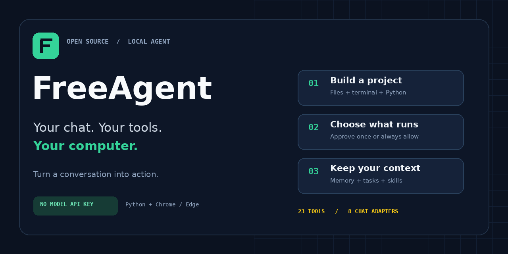

<div align="center">



# Turn your AI chat into a local agent.

**Build projects. Run commands. Remember context. Get things done on your computer.**

[](https://github.com/ta030700-boop/FreeAgent/actions/workflows/ci.yml)
[](LICENSE)


[**Get started**](#get-started) · [**Use ChatGPT**](docs/CHATGPT.md) · [**Example tasks**](docs/EXAMPLES.md) · [**Full guide**](docs/GUIDE.md) · [**Contribute**](CONTRIBUTING.md)

</div>

FreeAgent connects a normal browser AI conversation to a small Python bridge on your computer. The AI requests tools, you approve protected actions, and results return to the same chat. **No model API key is required.** Your chosen chat service's account requirements, quotas and rules still apply.

> **Early release · v0.1.3.** Eight adapters are included; live website compatibility depends on each provider's current UI. See [what has been tested](TESTING.md).

## Why FreeAgent?

| | What you get |
| --- | --- |
| **Your existing AI chat** | Adapters for DeepSeek, ChatGPT, Gemini, Kimi, GLM/Z.ai, Qwen, Arena Direct and Meta AI. |
| **A useful local toolbox** | Files, search, terminal, Python, public web pages and optional desktop control. |
| **Context that survives a new chat** | Workspace memory, task notes and reusable Markdown skills. |
| **Less repetitive approval** | Approve once, **Always allow this tool**, or Deny. Reset saved grants in Settings. |
| **Room to extend** | Add stdio MCP servers for other applications, with namespaced tools. |
| **Small, readable foundations** | Python bridge, browser extension, one core Python dependency and automated regression checks. |

## Get started

You need **Python 3.10+** and **Chrome or Edge**. Node.js is only needed to run contributor tests.

**1. Get the project**

Download the source ZIP from **Code → Download ZIP**, extract it, or clone:

```sh
git clone https://github.com/ta030700-boop/FreeAgent.git
cd FreeAgent
```

**2. Start the bridge**

| Windows | macOS / Linux |
| --- | --- |
| Double-click `start.bat` | Run `sh start.sh` |

The launcher creates a virtual environment and installs the bridge dependency. Keep its terminal open.

**3. Load the extension**

Open `chrome://extensions` or `edge://extensions`, enable **Developer mode**, choose **Load unpacked**, and select the project's **extension** folder.

**4. Pair and start**

Click the extension icon, paste the pairing token printed by the bridge, and select **Pair / save connection**. Choose **ChatGPT**, **DeepSeek** or another provider in the popup and click **Open**. Open a new conversation, click **Start agent**, and give it a task:

```text
Create a Python expense tracker in this workspace.
Add CSV import, write useful tests, run them,
and remember the project structure for our next session.
```

The default workspace is `workspace/`. Choose another folder with `--workspace` or `config.json`. See the [full setup and troubleshooting guide](docs/GUIDE.md).

## From a prompt to a finished task

1. **Describe the goal** in your chat.
2. **Review the action** when a protected tool is requested.
3. **Run locally** through the authenticated bridge.
4. **Return the result** to the AI so it can continue, correct an error, or finish.

The same conversation stays in control. Files, memory and task notes stay in your chosen workspace; tool output sent to the AI is processed by that chat provider.

## What can it do?

| Capability | Built-in tools |
| --- | --- |
| Inspect your environment | `system_info` |
| Read, write and search projects | `list_directory`, `read_file`, `write_file`, `edit_file`, `search_files` |
| Recover a removed file | `delete_path` moves the target to local trash |
| Execute code | `run_shell`, `run_python` |
| Read public web pages | `fetch_url`, `open_url` |
| Remember project context | `memory_get`, `memory_set`, `memory_delete` |
| Keep track of work | `task_create`, `task_update`, `task_list` |
| Reuse workflows | `skill_list`, `skill_read` |
| Control the desktop, optionally | `screen_capture`, `mouse_click`, `type_text`, `press_keys` |

**Try it with:** [a tested CLI](docs/EXAMPLES.md#build-a-small-cli), [a document index](docs/EXAMPLES.md#index-a-folder), or [a project handoff](docs/EXAMPLES.md#remember-a-project).

For desktop tools, run `install-desktop.bat` or `sh install-desktop.sh` after initial setup, then restart the bridge. OS permissions and a supported graphical session are required. ChatGPT's adapter currently disables screenshot uploads.

For external applications, add a stdio server to `config.json`. Tools appear as `server/tool_name`, and addon calls require approval or an explicit saved grant. [MCP setup →](docs/GUIDE.md#additional-mcp-servers)

## Approvals and trust

**Approve once** permits one call. **Always allow this tool** remembers the exact tool for the paired bridge, port and workspace, with any arguments. **Deny** ends the run. Use **Settings → Reset saved tool approvals** to ask again.

Built-in file tools stay inside the workspace and create backups for replaced files. File edits there do not prompt individually. Shell and Python run with your normal OS privileges: **the workspace is not a sandbox for executed code**. The pairing token is a local authority credential; keep it private.

**Stop** requests cancellation and terminates local shell/Python process trees. It cannot undo completed changes; third-party MCP cancellation is best effort. Read the [full behavior and privacy notes](docs/GUIDE.md#approvals-and-stopping) before granting persistent permissions.

## What to expect from this release

Keep the chat tab visible; switching tabs or minimizing pauses the loop. Provider UI changes may require adapter fixes. There are no unattended schedules, messaging channels, voice or subagents in this release. Task records are notes, not background jobs.

Automated checks exercise local tools, real WebSocket/subprocess transports, command parsing, remembered permissions and the shared agent loop. Provider website sessions and real desktop control still need manual validation. [Validation details →](TESTING.md)

## Build with us

Useful contributions include adapter fixes, OS testing, clearer examples and small reproducible bug reports. Start with [CONTRIBUTING.md](CONTRIBUTING.md), browse the [roadmap](docs/ROADMAP.md), or [open an issue](https://github.com/ta030700-boop/FreeAgent/issues).

If FreeAgent helps you, **star the repo** and share what you built. Real examples help other people get started.

## Credits and license

FreeAgent is an independent **GPL-3.0-or-later** derivative of [ZeroScript Free 1.5.5](https://github.com/sebattfg/ZeroScript-Free) by **sebattfg**. Its adapted provider/session engine powers the browser side; FreeAgent adds a general local backend, pairing, permissions, persistence and tests. See [NOTICE.md](NOTICE.md) and [LICENSE](LICENSE). No affiliation with OpenClaw, Hermes, Roblox or AI providers is implied.
